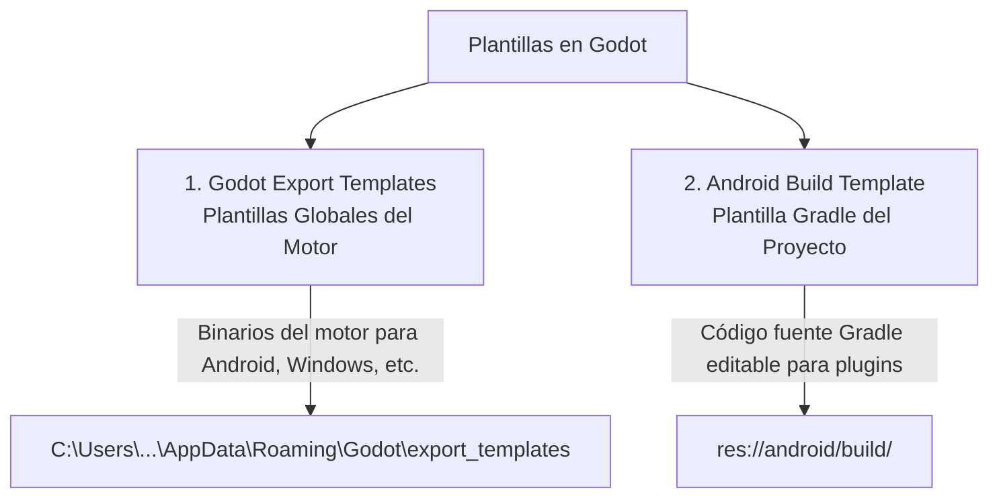

# 📱 Guía Definitiva: AdMob y Exportación a Android en Godot 4.x

Esta guía documenta el proceso completo y probado paso a paso para:
1. Instalar el **SDK de Android** y las **Plantillas de Godot (Templates)**.
2. Integrar publicidad oficial de **Google AdMob** (mediante el plugin oficial de Poing Studios).
3. Configurar **Anuncios de Prueba (Test Ads)** y registrar dispositivos seguros.
4. Configurar y compilar la **exportación nativa a Android con Gradle** sin errores.

---

## 📑 Tabla de Contenidos
1. [Configuración de Java JDK 17](#1-configuración-de-java-jdk-17)
2. [Instalación Paso a Paso del Android SDK](#2-instalación-paso-a-paso-del-android-sdk)
3. [Instalación de Plantillas de Godot (Export Templates y Build Template)](#3-instalación-de-plantillas-de-godot)
4. [Instalación del Plugin Poing Studios AdMob](#4-instalación-del-plugin-poing-studios-admob)
5. [Configuración de los IDs de AdMob (App ID y Bloques)](#5-configuración-de-los-ids-de-admob)
6. [Configuración de Anuncios de Prueba (Test Ads)](#6-configuración-de-anuncios-de-prueba)
7. [Estructura del Gestor de Anuncios (`AdministradorAnuncios.gd`)](#7-estructura-del-gestor-de-anuncios)
8. [Blindaje de Gradle y Corrección de Conflictos de Recursos](#8-blindaje-de-gradle-y-corrección-de-conflictos)
9. [Configuración de la Pantalla de Inicio (Splash) e Íconos](#9-configuración-de-la-pantalla-de-inicio-splash-e-íconos)
10. [Configuración del Preajuste de Exportación en Godot](#10-configuración-del-preajuste-de-exportación-en-godot)
11. [Exportación del APK / AAB y Pruebas con ADB](#11-exportación-del-apk--aab-y-pruebas-con-adb)
12. [Buenas Prácticas y Políticas de AdMob](#12-buenas-prácticas-y-políticas-de-admob)
13. [Tabla de Errores Comunes y Soluciones Rápidas](#13-tabla-de-errores-comunes-y-soluciones-rápidas)

---

## 1. Configuración de Java JDK 17

Android Gradle Plugin 8.x requiere estrictamente **JDK 17**:
- **Descarga:** [Eclipse Temurin OpenJDK 17 (LTS)](https://adoptium.net/temurin/releases/?version=17) o Oracle JDK 17.
- **Ruta típica de instalación en Windows:**
  `C:\Program Files\Eclipse Adoptium\jdk-17.x.x` o `C:\Program Files\Java\jdk-17`.
- **Variables de Entorno en Windows:**
  1. Presionar `Inicio` y buscar **"Editar las variables de entorno del sistema"**.
  2. En **Variables del sistema**, presionar **Nueva...**:
     - **Nombre:** `JAVA_HOME`
     - **Valor:** `C:\Program Files\Java\jdk-17` *(o tu ruta del JDK 17)*.
  3. Seleccionar la variable `Path`, presionar **Editar...** y agregar una nueva línea con: `%JAVA_HOME%\bin`.
  4. Abrir una nueva terminal (PowerShell o CMD) y verificar con:
     ```bash
     java -version
     ```
     *(Debe indicar version "17.0.x")*.

---

## 2. Instalación Paso a Paso del Android SDK

La manera oficial, más sencilla y libre de errores para instalar y mantener el SDK es mediante **Android Studio**.

### Paso 2.1: Descargar e Instalar Android Studio
1. Entrar en [developer.android.com/studio](https://developer.android.com/studio) y descargar el instalador oficial.
2. Ejecutar el instalador. En el asistente puedes dejar los componentes predeterminados marcados.

### Paso 2.2: Abrir el Administrador de SDK (SDK Manager)
1. Abrir Android Studio.
2. En la pantalla de bienvenida, haz clic en **More Actions** (o los tres puntos verticales) y selecciona **SDK Manager**.
   *(Si ya tienes un proyecto abierto, ve al menú superior: `Tools -> SDK Manager` o `File -> Settings -> Appearance & Behavior -> System Settings -> Android SDK`)*.
3. Observa la parte superior: verás la ruta oficial del SDK:
   `Android SDK Location: C:\Users\<TuUsuario>\AppData\Local\Android\Sdk`.
   *(Copia esta ruta, la necesitarás en Godot).*

### Paso 2.3: Descargar los componentes necesarios
Dentro del SDK Manager hay dos pestañas esenciales:

1. **Pestaña `SDK Platforms`:**
   - Marca la casilla de la versión objetivo moderna, por ejemplo:
     - ☑ **Android 14.0 ("UpsideDownCake") - API Level 34**
     - O ☑ **Android 15.0 - API Level 35**
2. **Pestaña `SDK Tools`:**
   Marca las siguientes casillas indispensables:
   - ☑ **Android SDK Build-Tools 34** (o 35).
   - ☑ **Android SDK Command-line Tools (latest)** *(crucial para que Godot detecte herramientas por consola)*.
   - ☑ **Android SDK Platform-Tools** *(incluye `adb.exe` para instalar y depurar en el celular)*.
3. Haz clic en **Apply** (Aplicar) y luego en **OK**.
4. Acepta el contrato de licencia y espera a que Android Studio termine de descargar e instalar los paquetes.

### Paso 2.4: Aceptar las Licencias del SDK
Abre una consola (PowerShell o CMD) y ejecuta:
```bash
C:\Users\<TuUsuario>\AppData\Local\Android\Sdk\cmdline-tools\latest\bin\sdkmanager.bat --licenses
```
*(Presiona `y` + Enter en cada una de las licencias hasta que termine diciendo "All SDK package licenses accepted")*.

### Paso 2.5: Generar la Clave de Depuración (`debug.keystore`)
Si no tienes un archivo `debug.keystore` en tu carpeta de usuario de Android, créalo ejecutando este comando en la terminal:
```bash
keytool -keyalg RSA -genkeypair -alias androiddebugkey -keypass android -keystore "%USERPROFILE%\.android\debug.keystore" -storepass android -dname "CN=Android Debug,O=Android,C=US" -validity 9999 -deststoretype pkcs12
```

### Paso 2.6: Vincular el SDK en Godot Engine
1. Abre Godot Engine.
2. Ve al menú superior: `Editor -> Configuración del Editor...` (Editor Settings).
3. En la barra lateral izquierda, baja hasta la sección: `Exportar -> Android` (Export -> Android).
4. Configura los 4 campos obligatorios:
   - **Android SDK Path:** `C:/Users/<TuUsuario>/AppData/Local/Android/Sdk` *(Usa barras inclinadas `/`)*.
   - **Debug Keystore:** `C:/Users/<TuUsuario>/.android/debug.keystore`
   - **Debug Keystore User:** `androiddebugkey`
   - **Debug Keystore Pass:** `android`

---

## 3. Instalación de Plantillas de Godot

En Godot existen **dos plantillas distintas** que cumplen funciones diferentes. Ambas son necesarias:



### 3.1 Plantillas Globales del Motor (Godot Export Templates)
Son los archivos binarios compilados del motor Godot para cada sistema operativo (Android APK, Windows EXE, WebAssembly, etc.).

**Cómo instalarlas:**
1. En Godot, haz clic en el menú superior: `Editor -> Administrar plantillas de exportación...` (Manage Export Templates).
2. Se abrirá una ventana que mostrará la versión exacta de tu motor (ejemplo: `4.7.2.stable`).
3. Haz clic en el botón **Descargar e instalar** (Download and Install).
4. El editor descargará automáticamente el paquete oficial correspondiente y lo guardará en tu sistema (`%APPDATA%\Godot\export_templates\`).
   *(Al finalizar, indicará "Estado: Instalado")*.

> [!TIP]
> **Instalación sin conexión a Internet directa en Godot:**
> Si tu editor no tiene acceso directo a Internet, puedes descargar el archivo `.tpz` manualmente desde [godotengine.org/download](https://godotengine.org/download) para tu versión exacta de Godot, y en esa misma ventana hacer clic en **Instalar desde archivo** (Install from File).

---

### 3.2 Plantilla de Compilación Android del Proyecto (Android Build Template)
Para que funcionen plugins nativos en Android (como **Google AdMob**, servicios de Google Play, compras in-app, etc.), no se puede usar el APK genérico preconstruido. Godot necesita compilar el proyecto usando **Gradle**, el compilador oficial de Android.

**Cómo instalarla en tu proyecto:**
1. Abre tu proyecto en Godot.
2. Ve al menú superior: `Proyecto -> Instalar plantilla de compilación de Android...` (Project -> Install Android Build Template...).
3. Aparecerá un aviso informando que se creará la carpeta de compilación nativa. Haz clic en **Instalar**.
4. En el panel del explorador de archivos de Godot verás una nueva carpeta en la raíz:
   `res://android/build/`
5. Esta carpeta contiene el archivo `build.gradle`, el archivo `AndroidManifest.xml` y los scripts de compilación de Gradle (`gradlew.bat`).

---

## 4. Instalación del Plugin Poing Studios AdMob

1. En Godot, haz clic en la pestaña superior derecha **AssetLib**.
2. En la barra de búsqueda escribe: `AdMob` o `Poing Studios`.
3. Haz clic sobre **Google Mobile Ads (Poing Studios)**.
4. Presiona **Descargar** (Download) y luego **Instalar** (Install).
5. Confirma que los archivos se instalen dentro de `res://addons/admob/`.
6. **Activar el Plugin:**
   - Ve al menú superior: `Proyecto -> Configuración del Proyecto...`
   - Haz clic en la pestaña **Plugins**.
   - Busca `AdMob` y marca la casilla **Activar** (Enabled).

---

## 5. Configuración de los IDs de AdMob

### 5.1 App ID (Nivel de Aplicación)
Tiene formato con **tilde (~)**:
`ca-app-pub-XXXXXXXXXXXXXXXX~YYYYYYYYYY`

Configúralo en dos sitios:
1. **En Godot:**
   `Proyecto -> Configuración del Proyecto -> General -> AdMob -> General`:
   - En `Android / App ID`: Pega el ID con `~`.
2. **En AndroidManifest.xml:**
   Abre el archivo `res://android/build/src/main/AndroidManifest.xml` e introduce dentro de `<application>`:
   ```xml
   <meta-data
       android:name="com.google.android.gms.ads.APPLICATION_ID"
       android:value="ca-app-pub-XXXXXXXXXXXXXXXX~YYYYYYYYYY"/>
   ```

### 5.2 Bloques de Anuncios (Ad Units)
Tienen formato con **barra (/)**:
`ca-app-pub-XXXXXXXXXXXXXXXX/ZZZZZZZZZZ`

- **App Open (Carga de Aplicación):** Para el inicio y retorno a la app.
- **Intersticial:** Para pausas completas entre niveles.
- **Recompensado (Rewarded):** Para revivir o dar monedas al usuario.

---

## 6. Configuración de Anuncios de Prueba (Test Ads)

> [!WARNING]
> **Peligro de suspensión de cuenta:** Google prohíbe terminantemente hacer clic o generar impresiones sobre tus propios anuncios de producción. Si haces pruebas con IDs de producción en tus dispositivos sin registrarlos como de prueba, Google puede suspender o inhabilitar tu cuenta de AdMob por **"Tráfico no válido"**.

Existen dos métodos seguros para probar anuncios durante el desarrollo:

### 6.1 Método 1: Usar los IDs Oficiales de Prueba de Google (Recomendado)
Google proporciona bloques de anuncios de prueba dedicados que siempre devuelven anuncios ficticios funcionales (como *"Test Ad"* o banners de prueba):

| Tipo de Anuncio | ID Oficial de Prueba (Android) | ID Oficial de Prueba (iOS) |
| :--- | :--- | :--- |
| **App ID de Prueba** | `ca-app-pub-3940256099942544~3347511713` | `ca-app-pub-3940256099942544~1458602516` |
| **App Open (Apertura)** | `ca-app-pub-3940256099942544/9257395921` | `ca-app-pub-3940256099942544/5575463023` |
| **Intersticial** | `ca-app-pub-3940256099942544/1033173712` | `ca-app-pub-3940256099942544/4411468910` |
| **Recompensado (Rewarded)** | `ca-app-pub-3940256099942544/5224354917` | `ca-app-pub-3940256099942544/1712485313` |
| **Banner** | `ca-app-pub-3940256099942544/6300978111` | `ca-app-pub-3940256099942544/2934735716` |

#### Implementación en GDScript:
En `administrador_anuncios.gd` puedes usar una variable para alternar fácilmente entre pruebas y producción:

```gdscript
# IDs de prueba oficiales de Google:
const ID_APP_OPEN_TEST     := "ca-app-pub-3940256099942544/9257395921"
const ID_INTERSTITIAL_TEST := "ca-app-pub-3940256099942544/1033173712"
const ID_REWARDED_TEST     := "ca-app-pub-3940256099942544/5224354917"

# IDs de producción de tu cuenta de AdMob:
@export var id_app_open_produccion: String = "ca-app-pub-TU_PUB_ID/TU_OPEN_ID"
@export var id_interstitial_produccion: String = "ca-app-pub-TU_PUB_ID/TU_INTER_ID"
@export var id_rewarded_produccion: String = "ca-app-pub-TU_PUB_ID/TU_REW_ID"

# Interruptor de pruebas:
@export var usar_anuncios_de_prueba: bool = true

func _obtener_id_intersticial() -> String:
	if usar_anuncios_de_prueba or id_interstitial_produccion == "":
		return ID_INTERSTITIAL_TEST
	return id_interstitial_produccion

func _obtener_id_rewarded() -> String:
	if usar_anuncios_de_prueba or id_rewarded_produccion == "":
		return ID_REWARDED_TEST
	return id_rewarded_produccion

func _obtener_id_app_open() -> String:
	if usar_anuncios_de_prueba or id_app_open_produccion == "":
		return ID_APP_OPEN_TEST
	return id_app_open_produccion
```

---

### 6.2 Método 2: Registrar tu Dispositivo como "Dispositivo de Prueba" (Test Device)
Si deseas usar tus IDs reales de producción para verificar que están correctamente enlazados con tu cuenta de AdMob, debes registrar tu teléfono como dispositivo de prueba:

1. **Obtener el ID de dispositivo desde los logs de ADB:**
   Conecta tu teléfono con depuración USB, abre la terminal y ejecuta:
   ```bash
   adb logcat -s Ads:*
   ```
   Al solicitar un anuncio, Google AdMob imprimirá una línea similar a:
   `Use RequestConfiguration.Builder().setTestDeviceIds(Arrays.asList("33BE2250B43518CC5...")) to get test ads on this device.`
   Copia ese código hash alfanumérico.

2. **Registrarlo en la Consola Web de AdMob:**
   - Ve a [admob.google.com](https://admob.google.com).
   - En el menú lateral izquierdo, haz clic en **Configuración** (Settings) -> **Dispositivos de prueba** (Test devices).
   - Haz clic en **Añadir dispositivo de prueba** (Add test device).
   - Selecciona la plataforma (Android), escribe un nombre (ej. *"Mi Celular Pruebas"*) e ingresa tu ID de publicidad (o el hash de ADB).
   - En el inspector de anuncios selecciona **Habilitado**.
   - Haz clic en **Guardar**.
   *(A partir de ese momento, AdMob mostrará una etiqueta "Test Ad" sobre todos los anuncios que se soliciten desde ese dispositivo, protegiendo tu cuenta de cualquier penalización).*

---

## 7. Estructura del Gestor de Anuncios (`AdministradorAnuncios.gd`)

Crea un script en `res://administrador_anuncios.gd` y regístralo como **Autoload** en:
`Proyecto -> Configuración del Proyecto -> Autoload -> Nombre: AdministradorAnuncios`.

### Principios Fundamentales:
1. **Pausa y Silenciamiento Estricto:** Cuando se despliega un anuncio nativo, se pausa el motor (`get_tree().paused = true`) y se silencia el bus maestro de audio. Al cerrar el anuncio, se restaura el estado previo.
2. **Bypass en Editor/PC:** Para probar niveles fluidamente con F5, los App Open automáticos no deben bloquear la pantalla en PC (`OS.has_feature("editor")`).
3. **Retención de Callbacks:** Los listeners de recompensa deben guardarse en una variable de clase (`_reward_listener`) para que el recolector de basura de Godot no los elimine mientras dura el video.
4. **Preservación del Progreso al Revivir:** Al morir, no restaures el nivel a su checkpoint en `game_over()`. Permite que el usuario vea el video bonificado y conserve su nivel actual, sus puntos acumulados y sus vidas restauradas con un escudo de 3.5 segundos.
5. **Mensajes Genéricos y Amables:** Si la red se demora en cargar el anuncio de revivir, muestra: `"Espere un momento e intente de nuevo"`.

---

## 8. Blindaje de Gradle y Corrección de Conflictos

### 8.1 Solución al Conflicto de Recursos Duplicados (`icon.png` vs `icon.webp`)
> [!IMPORTANT]
> La plantilla base de Godot en `android/build/res/mipmap*` incluye por defecto íconos `.webp`. Al exportar con íconos personalizados en `.png`, Android Gradle detiene la compilación con `Resource and asset merger: Duplicate resources`.

**Solución definitiva en `android/build/build.gradle`:**
Al final de `android/build/build.gradle`, agrega una tarea que elimine automáticamente cualquier archivo `.webp` antes de que comience el análisis de recursos:

```groovy
// Limpieza automática de íconos webp conflictivos antes de compilar
tasks.register('cleanDuplicateWebpIcons') {
    doFirst {
        fileTree(dir: 'res', include: ['**/icon.webp', '**/icon_foreground.webp']).each { File f ->
            if (f.exists()) f.delete()
        }
        fileTree(dir: 'res').matching { include '**/*-v4/**' }.each { File f ->
            if (f.exists()) f.delete()
        }
    }
}
preBuild.dependsOn 'cleanDuplicateWebpIcons'
afterEvaluate {
    tasks.matching { it.name.contains('merge') && it.name.contains('Resources') }.configureEach {
        dependsOn 'cleanDuplicateWebpIcons'
    }
}
```

### 8.2 Advertencia `compileSdk = 36`
En `android/build/gradle.properties`, agrega al final:
```properties
android.suppressUnsupportedCompileSdk=36
```

---

## 9. Configuración de la Pantalla de Inicio (Splash) e Íconos

Para que la app muestre tu propio ícono con fondo oscuro en lugar del logo clásico de Godot al abrir:

1. **En `project.godot`:**
   ```ini
   [application]
   config/name="Carril X"
   config/icon="res://icon.png"
   boot_splash/show_image=false
   boot_splash/bg_color=Color(0.04, 0.05, 0.09, 1)
   ```
2. Asegúrate de que `icon.png` sea un PNG auténtico y no un JPG renombrado.

---

## 10. Configuración del Preajuste de Exportación en Godot

1. Abre `Proyecto -> Exportar...`.
2. Haz clic en **Añadir... -> Android**.
3. Configura los siguientes parámetros:

### Gradle Build:
- **Use Gradle Build:** `Activado (On)`.
- **Export Format:** `Export APK` (pruebas locales) o `Export AAB` (subida a Google Play).

### Arquitecturas:
- **Arm64-v8a:** `Activado (On)` *(Obligatorio para Google Play).*
- **Armeabi-v7a:** `Desactivado` (opcional).

### Paquete (Package):
- **Unique Name:** `com.tuempresa.tujuego` (ejemplo: `com.carrilx.juego`).
- **Signed:** `Activado (On)`.

### Íconos del Lanzador (Launcher Icons):
- **Main 192x192:** `res://icon.png`
- **Adaptive Foreground 432x432:** `res://icon.png`

### Pantalla de Bienvenida (Splash Screen):
- **Disable Godot Boot Splash:** `Activado (On)`.
- **Icon:** `res://icon.png`
- **Background Color:** `#0a0d17`

### Permisos Requeridos:
- **Access Network State:** `Activado (On)`
- **Internet:** `Activado (On)`

---

## 11. Exportación del APK / AAB y Pruebas con ADB

### 11.1 Exportar APK para tu Celular
1. Conecta tu teléfono Android por cable USB y activa la **Depuración USB** en *Opciones de Desarrollador*.
2. En Godot, haz clic en **Exportar proyecto...**.
3. Elige el nombre del archivo (ejemplo: `CarrilX.apk`) y presiona **Guardar**.
4. Godot ejecutará Gradle y generará el archivo `.apk` compilado.

### 11.2 Instalar mediante ADB en la terminal
```bash
adb install -r "CarrilX.apk"
```

### 11.3 Ver los logs en vivo
```bash
adb logcat -s godot:* Ads:*
```

---

## 12. Buenas Prácticas y Políticas de AdMob

1. **No mostrar App Open sobre juego activo:** Si el jugador cambia de app y regresa mientras está en plena carrera o combate, no despliegues un anuncio de apertura.
2. **No hacer clic en tus propios anuncios:** Para pruebas reales, registra tu dispositivo en la consola de AdMob o mantén activos los IDs de prueba.
3. **Retroalimentación no invasiva:** Si el anuncio recompensado tarda en cargar por la red, avisa con mensajes claros y estándar como `"Espere un momento e intente de nuevo"`.
4. **Garantizar la recompensa:** Asegúrate de que ver el video completo restaure vidas y reanude la partida con el puntaje y nivel exacto que el jugador llevaba.

---

## 13. Tabla de Errores Comunes y Soluciones Rápidas

| Error Detectado | Causa Principal | Solución Probada |
| :--- | :--- | :--- |
| `Duplicate resources [mipmap/icon]` | Conflicto entre `icon.png` y `icon.webp` en `res/mipmap*`. | Agregar la tarea `cleanDuplicateWebpIcons` enganchada a `preBuild` en `android/build/build.gradle`. |
| `compileSdk = 36 untested` | Advertencia de compatibilidad de AGP 8.6.1 con Android 36. | Añadir `android.suppressUnsupportedCompileSdk=36` en `gradle.properties`. |
| `Not a PNG file / ERR_FILE_CORRUPT` | El archivo `icon.png` tiene extensión PNG pero es un JPEG o WebP. | Convertir la imagen a PNG genuino con cabecera `89 50 4E 47`. |
| Botón "Continue to app" congelado en PC | `get_tree().paused = true` congela los nodos con `process_mode` por defecto. | Colocar `process_mode = Node.PROCESS_MODE_ALWAYS` en los nodos del plugin mock de AdMob y omitir App Open en el editor de PC. |
| Recompensa no se acredita tras ver el video | El Garbage Collector de Godot liberó el listener durante el video de 30s. | Guardar `_reward_listener` en una variable de clase del script para mantenerlo en memoria. |
| El nivel retrocede al morir y revivir | `game_over()` reescribía `nivel_actual = checkpoint` antes de saber si el jugador reviviría. | Dejar el nivel y los puntos intactos en Game Over; aplicar el checkpoint únicamente si el jugador presiona *"Reintentar"* o vuelve al menú. |
