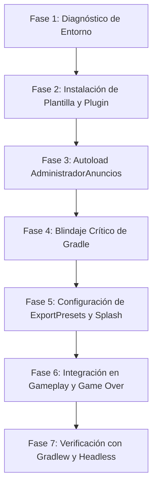

# 🤖 Playbook Operativo del Agente: AdMob y Exportación Android en Godot 4.x

> **Propósito:** Esta guía técnica define el procedimiento estándar para que el Agente de IA ejecute de forma autónoma, segura y sistemática la integración de **Google AdMob (Poing Studios)** y la **exportación nativa a Android (Gradle)** en cualquier proyecto de Godot Engine 4.x, diferenciando con precisión qué acciones son manuales del usuario y cuáles ejecuta el agente.

---

## 🧭 Matriz de Responsabilidades

| Componente | 👤 Usuario (Manual) | 🤖 Agente (Automático) |
| :--- | :--- | :--- |
| **Java JDK 17** | Instalar JDK 17 y configurar `JAVA_HOME`. | Verificar versión con `java -version` y detectar rutas. |
| **Android SDK** | Instalar SDK con Android Studio y aceptar licencias (`sdkmanager --licenses`). | Verificar rutas en `LocalAppData\Android\Sdk` y variables de entorno. |
| **Plantillas Godot** | `Editor -> Administrar plantillas de exportación... -> Descargar`. | Comprobar existencia en `%APPDATA%\Godot\export_templates\`. |
| **Plantilla Android** | `Proyecto -> Instalar plantilla de compilación de Android...`. | Auditar, reparar y blindar los archivos dentro de `res://android/build/`. |
| **Plugin AdMob** | Descargar desde AssetLib (si no se dispone de copia local). | Copiar/verificar `res://addons/admob/`, activarlo en `project.godot`. |
| **IDs de AdMob** | Proveer App ID (`~`) y Ad Units (`/`) de su cuenta. | Inyectar IDs en `project.godot`, `AndroidManifest.xml` y Autoload. |
| **Lógica de Anuncios** | Definir recompensas (vidas, monedas, revivir). | Crear `AdministradorAnuncios.gd` con pausas, audio y prevención de GC. |
| **Blindaje de Gradle** | Ninguna. | Parchear `build.gradle` (eliminar `.webp` duplicados) y `gradle.properties`. |
| **Preajustes Export** | Revisar en la GUI de Godot si se desea. | Generar y mantener `export_presets.cfg` (Gradle, arm64, splash, permisos). |
| **Jugabilidad** | Probar en el dispositivo o PC. | Blindar flujo de Game Over para conservar puntos y nivel al revivir. |
| **Compilación** | Exportar APK desde el diálogo de Godot. | Ejecutar `gradlew.bat assembleStandardDebug` para certificar éxito técnico. |

---

## 📋 Protocolo de Ejecución Paso a Paso



---

### Fase 1: Diagnóstico de Entorno (Toolchain Verification)

#### 🤖 Acciones del Agente:
1. Comprobar Java 17:
   ```powershell
   java -version
   cmd /c "echo %JAVA_HOME%"
   ```
   *Criterio de éxito:* Java 17.x. Si detecta Java 8 o Java 21+, instruir al usuario o setear temporalmente `JAVA_HOME` a la ruta de JDK 17 (por ej. `C:\Program Files\Java\jdk-17`).

2. Comprobar Android SDK y Build-Tools:
   ```powershell
   Test-Path "$env:LOCALAPPDATA\Android\Sdk\platforms"
   Test-Path "$env:LOCALAPPDATA\Android\Sdk\build-tools"
   ```

3. Comprobar Plantillas de Godot (Export Templates):
   ```powershell
   Get-ChildItem -Path "$env:APPDATA\Godot\export_templates"
   ```

#### 👤 Petición al Usuario (solo si falta algún componente):
- *"Por favor instala JDK 17 si no lo tienes configurado."*
- *"En Godot ve a Editor -> Administrar plantillas de exportación... y presiona Descargar e Instalar para tu versión de Godot."*

---

### Fase 2: Plantilla de Compilación Android y Plugin AdMob

#### 👤 Petición al Usuario (Estrictamente Manual):
- *"En Godot, ve a `Proyecto -> Instalar plantilla de compilación de Android...` y presiona Instalar (creará la carpeta `android/build`)."*

#### 🤖 Acciones del Agente:
1. Verificar que existe `res://android/build/build.gradle` y `res://android/build/AndroidManifest.xml`.
2. Verificar existencia de `res://addons/admob/`. Si no existe, copiarla o solicitar su descarga desde AssetLib.
3. Activar el plugin en `project.godot`:
   ```ini
   [editor_plugins]
   enabled=PackedStringArray("res://addons/admob/plugin.cfg")
   ```
4. Registrar App ID de AdMob:
   - En `project.godot`:
     ```ini
     [admob]
     general/android/app_id="ca-app-pub-XXXXXXXXXXXXXXXX~YYYYYYYYYY"
     ```
   - En `android/build/src/main/AndroidManifest.xml` dentro de `<application>`:
     ```xml
     <meta-data
         android:name="com.google.android.gms.ads.APPLICATION_ID"
         android:value="ca-app-pub-XXXXXXXXXXXXXXXX~YYYYYYYYYY"/>
     ```

---

### Fase 3: Implementación del Autoload de Anuncios

#### 🤖 Acciones del Agente:
Crear o actualizar `res://administrador_anuncios.gd` e inscribirlo en `project.godot`:
```ini
[autoload]
AdministradorAnuncios="*res://administrador_anuncios.gd"
```

#### Reglas Obligatorias en el Código del Autoload:
1. **Pausa y Silenciamiento:**
   ```gdscript
   func _pausar_para_anuncio() -> void:
       _anuncio_en_pantalla = true
       _estaba_pausado = get_tree().paused
       get_tree().paused = true
       AudioServer.set_bus_mute(AudioServer.get_bus_index("Master"), true)

   func _reanudar_tras_anuncio() -> void:
       _anuncio_en_pantalla = false
       if not _estaba_pausado:
           get_tree().paused = false
       AudioServer.set_bus_mute(AudioServer.get_bus_index("Master"), false)
   ```
2. **Bypass de App Open en Editor/PC:**
   ```gdscript
   if not mostrar_app_open_en_editor and (OS.has_feature("editor") or (OS.get_name() != "Android" and OS.get_name() != "iOS")):
       return
   ```
3. **Retención de Listeners para Evitar Recolección de Basura (GC):**
   - Mantener `_reward_listener` en una variable de clase (propiedad de instancia) antes de llamar a `_rewarded_ad.show(_reward_listener)`.
4. **Callbacks Diferidos en Intersticiales:**
   - Si `_interstitial_ad == null` al llamar a `mostrar_intersticial()`, ejecutar el callback de continuación inmediatamente para nunca dejar congelado el juego ante fallos de red.
5. **Plugins Mock para PC:**
   - En `res://addons/admob/internal/mock/*.gd`, verificar que `process_mode = Node.PROCESS_MODE_ALWAYS` esté asignado a `CanvasLayer` y `ColorRect`, para que los clics sigan funcionando cuando el juego esté en pausa.

---

### Fase 4: Blindaje Crítico de Gradle (Anti-Errores)

Este paso es **100% automático del Agente** y previene los fallos más frecuentes de exportación en Godot 4.

#### 🤖 Acciones del Agente:
1. **Evitar Duplicate Resources (`icon.png` vs `icon.webp`):**
   Inyectar al final de `android/build/build.gradle`:
   ```groovy
   // Auto-clean conflicting webp launcher icons before merging Android resources
   tasks.register('cleanDuplicateWebpIcons') {
       doFirst {
           fileTree(dir: 'res', include: ['**/icon.webp', '**/icon_foreground.webp']).each { File f ->
               if (f.exists()) f.delete()
           }
           fileTree(dir: 'res').matching { include '**/*-v4/**' }.each { File f ->
               if (f.exists()) f.delete()
           }
       }
   }
   preBuild.dependsOn 'cleanDuplicateWebpIcons'
   afterEvaluate {
       tasks.matching { it.name.contains('merge') && it.name.contains('Resources') }.configureEach {
           dependsOn 'cleanDuplicateWebpIcons'
       }
   }
   ```
2. **Suprimir advertencia de `compileSdk = 36`:**
   En `android/build/gradle.properties`, agregar:
   ```properties
   android.suppressUnsupportedCompileSdk=36
   ```

---

### Fase 5: Configuración de Exportación y Splash Screen

#### 🤖 Acciones del Agente:
1. **Verificar que `icon.png` sea un PNG real:**
   - Comprobar que los primeros bytes correspondan a `89 50 4E 47`. Si es JPEG disfrazado, convertirlo a PNG genuino para evitar `Not a PNG file / ERR_FILE_CORRUPT`.
2. **Configurar Splash e Íconos en `project.godot`:**
   ```ini
   [application]
   config/icon="res://icon.png"
   boot_splash/show_image=false
   boot_splash/bg_color=Color(0.04, 0.05, 0.09, 1)
   ```
3. **Configurar `export_presets.cfg`:**
   Asegurar las claves críticas para Android:
   ```ini
   [preset.0.options]
   gradle_build/use_gradle_build=true
   architectures/arm64-v8a=true
   architectures/armeabi-v7a=false
   package/signed=true
   launcher_icons/main_192x192="res://icon.png"
   launcher_icons/adaptive_foreground_432x432="res://icon.png"
   splash_screen/disable_godot_boot_splash=true
   splash_screen/icon="res://icon.png"
   splash_screen/background_color=Color(0.04, 0.05, 0.09, 1)
   permissions/access_network_state=true
   permissions/internet=true
   ```

---

### Fase 6: Integración en Jugabilidad y Game Over

#### 🤖 Acciones del Agente (Reglas de Oro de UX):
1. **No Reiniciar Nivel en `game_over()`:**
   - ❌ **INCORRECTO:** Asignar `DatosNiveles.nivel_actual = checkpoint` al momento de morir.
   - ✅ **CORRECTO:** Mantener el nivel y los puntos intactos en Game Over.
   - Solo degradar al `checkpoint` si el jugador presiona *"REINTENTAR NIVEL"* o vuelve al *"MENÚ PRINCIPAL"*.
2. **Continuidad Exacta al Revivir:**
   - Al ver el video bonificado: restaurar vidas (ej. 2 vidas), activar escudo de 3.5 segundos, limpiar obstáculos inmediatos y mantener el nivel y puntaje acumulado exactos.
3. **Mensaje Amigable de Espera en Botón:**
   - Si el anuncio aún no termina de cargar al hacer clic:
     ```gdscript
     lbl.text = "Espere un momento e intente de nuevo"
     ```
     *(Evitar mensajes técnicos como "CARGANDO... REINTENTA EN 2s")*.

---

### Fase 7: Certificación Técnica

#### 🤖 Acciones del Agente:
1. **Validación Headless de Godot:**
   ```powershell
   & "RUTA_GODOT\Godot.exe" --headless --check-only
   ```
   *Debe arrojar Exit Code 0 sin errores de sintaxis GDScript.*

2. **Compilación de Prueba con Gradle Wrapper:**
   ```cmd
   set JAVA_HOME=C:\Program Files\Java\jdk-17
   set ANDROID_HOME=C:\Users\<Usuario>\AppData\Local\Android\Sdk
   cd android\build
   gradlew.bat assembleStandardDebug
   ```
   *Debe terminar con `BUILD SUCCESSFUL`.*

#### 👤 Petición Final al Usuario:
- *"La compilación interna con Gradle y AdMob ha sido validada con éxito. Ya puedes abrir la ventana `Proyecto -> Exportar...` en Godot y generar tu archivo APK con un solo clic."*

---

## 🛠️ Checklist Rápido de Emergencia (Quick Fixes)

| Síntoma | Diagnóstico del Agente | Solución Inmediata |
| :--- | :--- | :--- |
| `:mergeStandardDebugResources FAILED` | Archivos `.webp` de la plantilla compiten con los `.png`. | Verificar que la tarea `cleanDuplicateWebpIcons` esté enganchada a `preBuild` en `android/build/build.gradle`. |
| `License for package ... not accepted` | Licencias de Android 34/35/36 sin aceptar. | Pedir al usuario ejecutar `sdkmanager.bat --licenses` y presionar `y`. |
| `Invalid Java version` | Gradle se ejecutó con Java 8 o 21. | Especificar `JAVA_HOME=C:\Program Files\Java\jdk-17` antes de invocar `gradlew`. |
| La app inicia con el robot de Godot | Splash nativo de Android activo con imagen por defecto. | Poner `splash_screen/disable_godot_boot_splash=true` y `boot_splash/show_image=false`. |
| El juego congela botones en PC | Árbol pausado congela el simulador de AdMob. | Agregar `process_mode = Node.PROCESS_MODE_ALWAYS` en los plugins mock. |
| El jugador revive en el Nivel 1 en vez del suyo | `game_over()` sobrescribió el nivel al checkpoint al morir. | Quitar el reseteo de checkpoint de `game_over()`; moverlo solo al botón Reintentar o Salir. |
