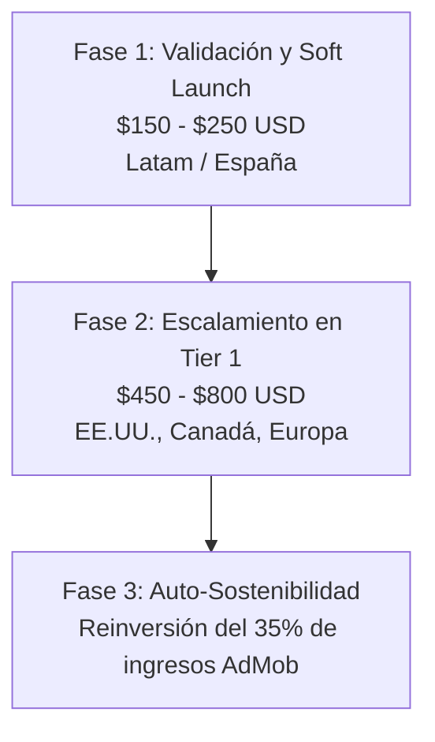

# 🚗 Estudio Financiero y Presupuesto de Inversión: Car Dodge 2D (Android & iOS)

Este análisis financiero y presupuesto de inversión está diseñado **exclusivamente para *Car Dodge 2D***, considerando sus mecánicas clave: esquivar autos en carriles, recolección de monedas, potenciadores (escudo y reloj ralentizador), desbloqueo de vehículos en el garaje y reintentos por checkpoints.

---

## 1. 💰 Costos Fijos de Publicación en Tiendas

Para publicar *Car Dodge 2D* en las dos plataformas móviles principales de forma profesional:

| Concepto | Costo (USD) | Periodicidad | Requisitos y Consideraciones para Car Dodge 2D |
| :--- | :---: | :---: | :--- |
| **Google Play Console (Android)** | **$25.00** | Pago único vitalicio | Permite publicar y actualizar el APK/AAB de *Car Dodge 2D* indefinidamente. **Requisito Google (2024-2026):** Requiere una prueba cerrada previa de 14 días continuos con mínimo 12-20 testers antes de abrir a producción pública. |
| **Apple Developer Program (iOS)** | **$99.00** | Anual | Requerido para publicar en la App Store y distribuir por TestFlight. |
| **Entorno macOS / Xcode (iOS)** | **$0 - $350.00** | Único o suscripción | Para generar el `.ipa` de *Car Dodge 2D* desde Godot se requiere Xcode (macOS): • Si ya cuentas con Mac: **$0 USD**. • Si estás en Windows: Mac Mini M1 usado (~$350 USD), servicio cloud (*MacInCloud* a ~$25/mes) o compilar vía *GitHub Actions* con runner macOS (gratuito para proyectos abiertos/tier básico). |
| **Dominio y Política de Privacidad** | **$0.00** | Permanente | Se puede alojar la política de privacidad obligatoria sin costo en **GitHub Pages** con un diseño simple en HTML/Markdown. |
| **Subtotal Fijo (Solo Android):** | **$25.00** | — | **Mínimo absoluto para salir al mercado.** |
| **Subtotal Fijo (Android + iOS con Mac propio):** | **$124.00** | Primer año | **Cobertura de ambas tiendas globales.** |

---

## 2. 📢 Presupuesto de Marketing y Adquisición de Usuarios (UA)

Los juegos arcade de esquivar vehículos (*traffic dodgers / runners*) tienen una ventaja competitiva muy alta en redes sociales: **los videos cortos de choques espectaculares y esquivas por milímetros tienen un alto potencial viral orgánico**.

### Fase 1: Soft Launch y Validación Técnica ($150 - $250 USD)
* **Objetivo:** Auditar la retención de jugadores (Día 1 y Día 7), tasa de clics en el botón *"VER ANUNCIO"* para revivir, y verificar la ausencia de ANRs (bloqueos) en diversos modelos de teléfonos.
* **Canales:**
  * **TikTok Ads & Meta Ads (Instagram Reels):** Videos de 7 a 12 segundos mostrando gameplay rápido de *Car Dodge 2D* con música enérgica y choques de último segundo.
  * **Google App Campaigns (UAC):** Descargas automáticas optimizadas para volumen en Google Play.
* **Segmentación:** México, Colombia, Argentina, España (CPI ultra económico: **$0.08 a $0.20 USD** por instalación).
* **Volumen esperado:** **1,200 a 2,500 instalaciones iniciales**.

### Fase 2: Escalamiento en Mercados de Alto eCPM ($450 - $800 USD)
* **Objetivo:** Adquirir jugadores en Estados Unidos, Reino Unido, Alemania y Canadá, donde las empresas de seguros de autos, marcas de vehículos y otros juegos pautan fuertemente en AdMob.
* **Costo por Instalación (CPI) en Tier 1:** **$0.65 a $1.30 USD**.
* **Volumen esperado:** **1,000 a 1,800 jugadores de alto valor publicitario**.

---

## 3. 🚗 Estrategia de Monetización Específica para Car Dodge 2D

La economía de *Car Dodge 2D* combina anuncios nativos de AdMob con la progresión del garaje:

### 1. Rewarded Ads (Videos Bonificados) - Formato Estrella
* **Revivir al chocar:** El jugador conserva su nivel alcanzado, puntaje y velocidad, recibiendo 2 vidas y 3.5 segundos de escudo invulnerable. *(Alta tasa de aceptación: 60-70% de los jugadores usan al menos 1 revive por sesión).*
* **Duplicar Monedas de la partida:** Al llegar a Game Over final, opción de duplicar el oro recolectado para comprar autos más rápido en el garaje.
* **Bono de Monedas en Garaje:** Botón `+50 Monedas gratis` en la tienda tras ver un video publicitario.

### 2. Anuncios Intersticiales (Pantalla Completa)
* **Ubicación:** Únicamente al presionar *"REINTENTAR NIVEL"* o al volver al *"MENÚ PRINCIPAL"* tras perder definitivamente.
* **Frecuencia (Frequency Capping):** Máximo 1 intersticial cada 2.5 a 3 minutos para no fatigar al usuario.

### 3. App Open Ad
* Se muestra una sola vez al abrir el juego en el dispositivo físico móvil, previo al menú principal.

### Benchmark de eCPM y LTV para Juegos de Coches 2D

| Formato | eCPM Tier 1 (EE.UU./CA/UK) | eCPM Tier 2/3 (Latam/España) | Frecuencia media diaria |
| :--- | :---: | :---: | :---: |
| **Rewarded Ad (Revivir / Oro)** | **$18.00 - $38.00** | **$2.80 - $6.50** | 2.5 vistas / jugador |
| **Intersticial (Entre partidas)** | **$7.00 - $15.00** | **$1.40 - $3.20** | 3.0 vistas / jugador |
| **App Open (Apertura)** | **$5.00 - $11.00** | **$0.90 - $2.20** | 1.2 vistas / jugador |

* **LTV (Valor de por vida) estimado por jugador:**
  * **Jugador Latam / España:** **$0.04 - $0.09 USD**
  * **Jugador Tier 1 (EE.UU./Europa):** **$0.35 - $0.75 USD**
  * Si se añade una compra integrada IAP *"Desbloquear Todos los Autos + Sin Anuncios"* a **$1.99 USD**, el LTV promedio global sube un **35% adicional**.

---

## 4. 🔮 Proyecciones Financieras para Car Dodge 2D (A 6 Meses)

Considerando una inversión inicial equilibrada de **$600 USD** ($25 consola Android + $575 en campañas de marketing y creativos):

| Escenario | Descargas Totales | Jugadores Activos Mensuales (MAU) | Ingresos AdMob Estimados | Ingresos IAP (Sin Anuncios / Autos) | Beneficio Neto (Ganancia Real) | Retorno (ROI) |
| :--- | :---: | :---: | :---: | :---: | :---: | :---: |
| **Conservador** *(Retención D1: 24%, tráfico básico, sin viralidad)* | 6,000 | ~950 | $280 - $420 | $50 - $90 | **-$270 a -$90 (Cerca del punto de equilibrio)** | -45% a -15% |
| **Moderado (Objetivo)** *(Retención D1: 34%, buen ASO de "juegos de autos", campañas optimizadas)* | **28,000** | **~4,800** | **$1,350 - $2,200** | **$250 - $500** | **+$1,000 a +$2,100** | **+166% a +350%** |
| **Exitoso / Viral** *(Retención D1: >42%, video viral en TikTok de choques, destacado en Google Play)* | **120,000** | **~22,000** | **$6,200 - $11,500** | **$1,200 - $2,400** | **+$6,800 a +$13,300** | **+1,100%+** |

---

## 5. 🇨🇴 Proyección de Ganancias Mensuales en Pesos Colombianos (COP)

Tomando como referencia una tasa de cambio promedio de **1 USD ≈ $4,000 COP** (rango usual $3,900 - $4,200 COP), estas son las posibles ganancias recurrentes mensuales que puede generar *Car Dodge 2D* una vez estabilizado en las tiendas:

| Escenario Mensual | Jugadores Diarios (DAU) | Jugadores Mensuales (MAU) | Ingreso Mensual (USD) | 💵 Ganancia Mensual en COP | Equivalencia en Colombia |
| :--- | :---: | :---: | :---: | :---: | :--- |
| **1. Arranque / Orgánico Base** *(Sin pauta activa, solo amigos y búsquedas orgánicas)* | 70 - 150 | 1,200 - 2,500 | $40 - $100 USD | **$160,000 - $400,000 COP** | Ingreso pasivo inicial. Cubre costos de conectividad y servicios. |
| **2. Crecimiento Estable (Objetivo)** *(Campaña inicial corrida, buen ASO, retención moderada)* | 600 - 1,500 | 10,000 - 25,000 | $300 - $800 USD | **$1,200,000 - $3,200,000 COP** | **1 a 2 Salarios Mínimos (SMMLV)** generados de forma 100% pasiva y recurrente. |
| **3. Tracción Alta / Escalamiento** *(Clips virales en TikTok, tráfico mixto Latam + 20% EE.UU.)* | 3,000 - 7,500 | 45,000 - 100,000 | $1,500 - $3,500 USD | **$6,000,000 - $14,000,000 COP** | Ingreso de nivel profesional / desarrollador senior en Colombia. |
| **4. Éxito Viral Internacional** *(Destacado en Google Play / App Store con fuerte audiencia Tier 1)* | 15,000+ | 200,000+ | $5,000 - $12,000+ USD | **$20,000,000 - $48,000,000+ COP** | Capacidad para reinvertir y fundar un estudio independiente completo. |

> **Nota sobre Pagos en Colombia:** Google AdMob transfiere las ganancias mensuales en dólares directamente a tu cuenta bancaria colombiana (Bancolombia, Davivienda, etc.) vía transferencia internacional bancaria (código SWIFT) una vez superado el umbral mínimo de cobro ($100 USD ≈ $400,000 COP), convirtiéndolo automáticamente a pesos colombianos a la TRM del día sin intermediarios complicados.

---

## 6. 🛠️ Hoja de Ruta Financiera Recomendada para Car Dodge 2D

```mermaid
gantt
    title Cronograma de Inversión y Ejecución para Car Dodge 2D
    dateFormat  X
    axisFormat Semana %s
    section Setup y Pruebas
    Cuenta Google Play ($25) y Closed Testing :active, 0, 2
    section Lanzamiento Android
    Soft Launch en Latam ($150)             : 2, 4
    Ajustes de dificultad y ASO             : 4, 6
    section Escalamiento
    Campañas Tier 1 ($450) y TikTok Viral   : 6, 10
    Lanzamiento iOS (App Store $99)         : 10, 12
```

1. **Mes 1: Salida en Google Play ($25 USD)**
   * Publicar en Android. Realizar la prueba cerrada de 14 días con conocidos y comunidades indie.
   * Ejecutar la Fase 1 de anuncios con $150 USD en México, Colombia y España.
   * Verificar en la consola de AdMob que el botón *"VER ANUNCIO"* para revivir funcione sin caídas y genere un eCPM sano.

2. **Mes 2: Optimización del Garaje y Viralidad Orgánica ($0 USD de inversión extra)**
   * Publicar en TikTok / Instagram Reels clips cortos de gameplay de *Car Dodge 2D* (por ejemplo: *"Intentando pasar el Nivel 4 con el camión"* o *"Casi choco pero activé el reloj"*).
   * Los juegos de esquivar coches tienen una de las tasas de descarga orgánica más altas en TikTok si se usan audios en tendencia.

3. **Mes 3: Reinversión en Tier 1 y Expansión a iOS ($99 USD)**
   * Con las ganancias generadas por AdMob en el primer mes, pagar la cuenta de Apple ($99 USD) para lanzar *Car Dodge 2D* en la App Store.
   * Enfocar el presupuesto publicitario restante en EE.UU. y Europa para maximizar el cobro de eCPM en dólares.
